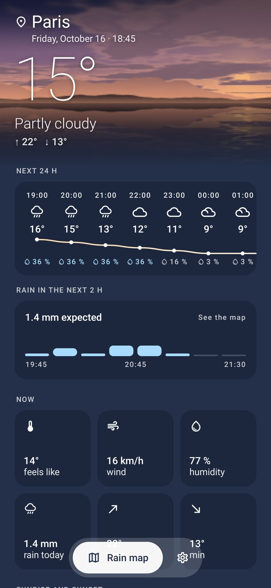
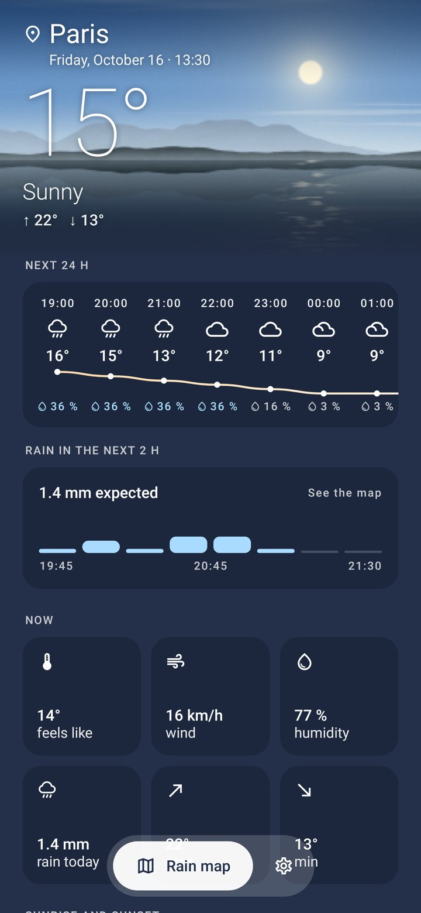
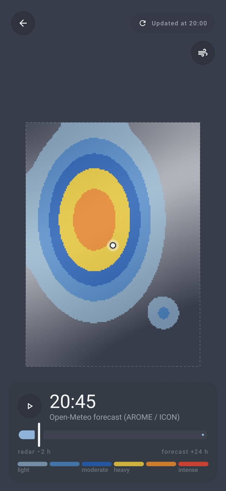

# YAMA — Yet Another Meteo App

[](https://github.com/julienbrunet/yama/actions/workflows/android.yml)
[](https://github.com/julienbrunet/yama/security)
[](https://github.com/julienbrunet/yama/actions/workflows/pages.yml)

**Local weather on Android, nothing else**: no ads, no tracking, no account.
A free and open-source weather app built on open weather data. Available in English and French.

🌐 **Website: https://julienbrunet.github.io/yama/**

📥 **Download the latest version: [yama.apk](https://github.com/julienbrunet/yama/releases/latest/download/yama.apk)**
(the app then updates itself from GitHub Releases)

<p align="center">
  
  
  
</p>

## Features

- **Your location** by default (GPS, never shared) and saved places.
- **Rain over the next 2 hours, every 15 minutes** (high-resolution AROME / ICON models),
  24 hours hour by hour, 7 days, sunrise and sunset, an alert when rain is due within the hour.
- **Rain map**: observed radar then a smooth animated forecast, Meteosat satellite and forecast clouds,
  wind map on demand; Météo-France AROME-PI nowcast with your own free key (optional).
- **Six widgets** (Mini, Rain, Day, 12 h, Week, Rain map), each with its own background, transparency and text colour.
- **Five themes**: Slate (light / dark), Sky, Pastel, Aurora and **Nature**, whose mountain and lake landscape
  follows the time of day and the weather.
- **English and French**, following the phone's language (or the per-app language on Android 13+).
- **Zero ads, zero tracking**: no advertising or analytics SDK, no Google services (F-Droid compatible).

## Data sources

[Open-Meteo](https://open-meteo.com) (forecasts, geocoding), [RainViewer](https://www.rainviewer.com) (radar),
[EUMETSAT](https://view.eumetsat.int) (Meteosat satellite), [Météo-France](https://portail-api.meteofrance.fr) (AROME-PI, optional),
[OpenStreetMap](https://www.openstreetmap.org) (map background).

## Building

Requirements: JDK 21 and the Android SDK (platform 37). From `android-app/`:

```bash
./gradlew assembleDebug                         # debug APK in app/build/outputs/apk/debug/
./gradlew testDebugUnitTest                     # unit tests
./gradlew recordRoborazziDebug                  # screenshots in app/screenshots/ (English) and app/screenshots/fr/
```

There is no emulator in CI: screens and widgets are rendered on the JVM with Robolectric and Roborazzi.
Every downloaded dependency is checked against `android-app/gradle/verification-metadata.xml`.

## Repository

- [`android-app/`](android-app/): Android app (Kotlin, Jetpack Compose); architecture in [`android-app/ARCHITECTURE.md`](android-app/ARCHITECTURE.md)
- [`site/`](site/): presentation page (English and French), published on GitHub Pages
- [`.github/workflows/`](.github/workflows/): CI (tests, screenshots, signed APK, release), security analyses and website deployment
