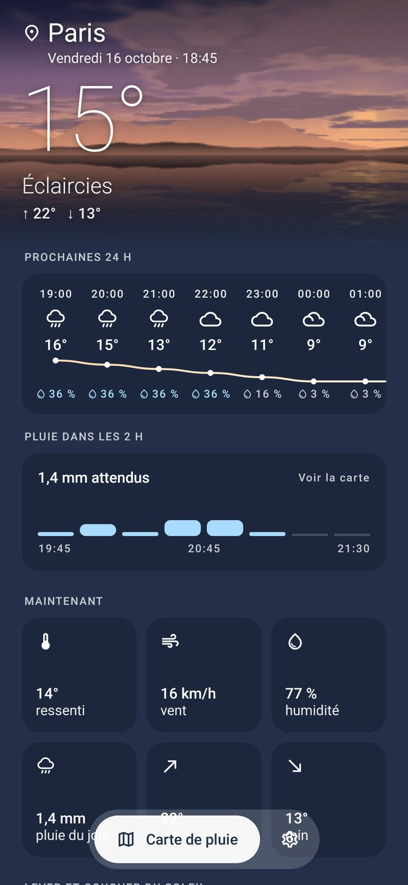
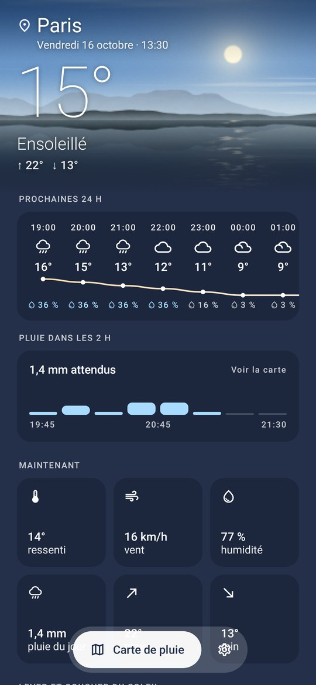

# No Ad Météo

**La météo locale sur Android, rien d'autre** : pas de publicité, pas de pistage, pas de compte.
Application gratuite et open-source, basée sur des données météo ouvertes.

🌐 **Site de présentation : https://julienbrunet.github.io/namm/**

📥 **Télécharger la dernière version : [no-ad-meteo.apk](https://github.com/julienbrunet/namm/releases/latest/download/no-ad-meteo.apk)**
(l'application se met ensuite à jour toute seule depuis les GitHub Releases)

  
  
  

## Fonctionnalités

- **Votre position** par défaut (GPS, jamais partagé) et des lieux enregistrés.
- **Pluie des 2 prochaines heures au quart d'heure** (modèles haute résolution AROME / ICON),
  24 h heure par heure, 7 jours, lever et coucher du soleil, alerte quand la pluie arrive dans l'heure.
- **Carte de pluie** : radar observé puis prévision animée et fluide, nuages satellite Meteosat et prévus,
  carte des vents à la demande ; prévision Météo-France AROME-PI avec votre propre clé (facultatif).
- **Six widgets** (Mini, Pluie, Journée, 12 h, Semaine, Carte de pluie), chacun avec son fond, sa transparence et sa couleur de texte.
- **Cinq thèmes** : Ardoise (clair / sombre), Ciel, Pastel, Aurore et **Nature**, dont le paysage de montagnes
  et de lac suit l'heure du jour et le temps qu'il fait.
- **Zéro publicité, zéro pistage** : aucun SDK publicitaire ni analytics, aucun service Google (compatible F-Droid).

## Sources de données

[Open-Meteo](https://open-meteo.com) (prévisions, géocodage), [RainViewer](https://www.rainviewer.com) (radar),
[EUMETSAT](https://view.eumetsat.int) (satellite Meteosat), [Météo-France](https://portail-api.meteofrance.fr) (AROME-PI, facultatif),
[OpenStreetMap](https://www.openstreetmap.org) (fond de carte).

## Dépôt

- [`android-app/`](android-app/) : application Android (Kotlin, Jetpack Compose) ; architecture dans [`android-app/ARCHITECTURE.md`](android-app/ARCHITECTURE.md)
- [`site/`](site/) : page de présentation, publiée sur GitHub Pages
- [`.github/workflows/`](.github/workflows/) : CI (tests, captures d'écran, APK signé, release) et déploiement du site
