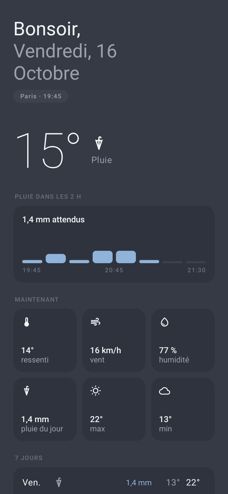

# NAMM — No Ad Mobile Météo

Application mobile de météo locale, **sans publicité ni tracking**, basée sur des API météo gratuites et ouvertes.

- [`android-app/`](android-app/) — application Android (Kotlin + Jetpack Compose)
- Architecture technique : [`android-app/ARCHITECTURE.md`](android-app/ARCHITECTURE.md)
- [`site/`](site/) — page de présentation (GitHub Pages)

📥 Télécharger la dernière version : [no-ad-meteo.apk](https://github.com/julienbrunet/namm/releases/latest/download/no-ad-meteo.apk)

